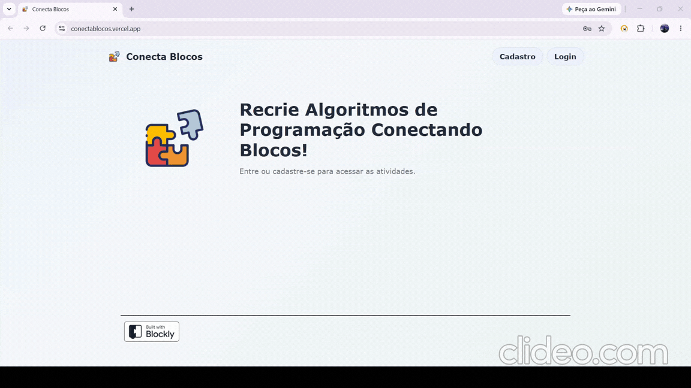

# Projeto: Aplicação com cadastro e autenticação de usuários integrando frontend, backend e persistência



## Acesso
Acesso ao app: [conectablocos.vercel.app](conectablocos.vercel.app)

Como o deploy do backend está no Render, é possível que haja algum atraso na resposta se ele estiver "adormecido". Para resolver isso, é só esperar ou acessá-lo em: [deploy backend](https://conecta-blocos-backend.onrender.com).

## Desenvolvedores
**Giovana Borelli** - Ciência da Computação  
**Lucas Xavier Pairé** - Ciência da Computação

## Proposta
Realizar uma expansão dos projetos:
- https://github.com/elc1090/project2-2026b-GiBorelli
- https://github.com/elc1090/project2-2026b-lucasxpaire

Com as seguintes modificações:
Primeiramente, criaremos dois cadastros diferentes: Professor e Aluno. O Professor poderá criar questões novas para a aplicação. O Aluno somente terá acesso a responder questões pré-definidas. Depois, iremos alterar o comportamento e registro das questões da aplicação, buscando maior flexibilidade no conteúdo delas e na correção dos gabaritos. Uma funcionalidade extra (ainda em discussão de viabilidade) seria a criação de Turmas, em que o Professor terá acesso aos dados de registro dos Estudantes e poderia definir quais questões eles podem acessar. 

## Desenvolvimento

### Processo

Como o trabalho era em dupla, dividimos algumas funcionalidades para cada um implementar. Inicialmente a Giovana ficou responsável por organizar os formatos da criação das questões e o Lucas por procurar alternativas ao Render para o banco de dados e quão viável seria o deploy. Infelizmente, o deploy no Railway teve um problema da própria plataforma, assim retornamos ao Render.

- Relato da Giovana:

Para a criação de questões na própria aplicação, decidiu-se adicionar dois métodos: área de criação com blocos ou adição por arquivo json (que deve estar no mesmo formato do arquivo [padrão](./backend/questoes.json)). Preparou-se essa fucionalidade para diferenciar as permissões de Professores e Alunos. O principal problema identificado é na repetição de títulos de questões já no banco de dados, pois constrói-se o identifcador único por esse valor.

Posteriormente, fiquei responsável por criar e reorganizar as telas, utilizando os pontos de acesso definidos pelo Lucas. Neste momento, foi necessário mapear cada função às autorizações dos usuários e quais funcionalidades deveriam aparecer para cada tipo. Adicionou-se também tela de home, cadastro e login para preencher os campos a serem inseridos no banco de dados. No final, algumas escolhas de design foram alteradas ou corrigidas.  

- Relato do Lucas:

Sobre a parte desenvolver a autenticação e autorização no backend, a primeira parte foi pensar na modelagem da nova entidade de usuário e pensar em quais dados essa entidade suportaria. Então pensamos no email, nome, senha transformada em hash e o tipo do usuário. Esses dados são suficientes para que não guardássemos a senha em texto puro e o tipo do usuário para gerenciar as autorizações dele.

Depois foi implementada a emissão e validação de tokens JWT, também foi feita a autorização baseada no tipo de usuário utilizando injeção de dependências do FastAPI, garantindo que qualquer tentativa de criar ou importar questões por alguém sem perfil de professor seja travada na API. Por último, foi implementado o salvamento do token no localStorage para que o usuário logado não tenha que fazer login novamente ao atualizar a página. Também foi implementado o envio do token no cabeçalho das requisições para permitir que o backend consiga obter o token e validar para saber se o usuário pode ou não fazer aquela requisição.

### Trechos de código
1. Controle de acesso por papel: pra garantir que os alunos não consigam criar questões mesmo se fizerem requisições diretas para a API, foi criado uma dependência que verifica o token JWT, busca o usuário e valida se o seu papel é de professor.

```
async def require_professor(current_user: Usuario = Depends(get_current_user)) -> Usuario:
    if current_user.tipo_usuario != "professor":
        raise HTTPException(
            status_code=status.HTTP_403_FORBIDDEN,
            detail="Acesso restrito: apenas professores podem criar ou importar questões."
        )
    return current_user
```

2. Proteção e validação de senhas com bcrypt

Implementado funções para transformar uma senha pura em hash e para checagem das senhas usando a biblioteca bcrypt. O algoritmo gera um salt, que é uma sequência de bytes aleatórios para cada usuário e o combina com a senha antes de gerar o hash. Dessa forma mesmo que dois usuários usem a mesma senha, as suas senhas em hash serão diferentes no banco de dados.

```
def generate_hash(password: str) -> str:
    bytes_password = password.encode("utf-8")
    salt = bcrypt.gensalt()
    hash_bytes = bcrypt.hashpw(bytes_password, salt)
    return hash_bytes.decode("utf-8")

def verify_password(plain_password: str, hashed_password: str) -> bool:
    return bcrypt.checkpw(
        plain_password.encode("utf-8"),
        hashed_password.encode("utf-8")
    )
```

3. Para definir cada característica que cada tela terá acesso, utilizou-se a seguinte estrutura no html e adição/retirada de "hidden" nos botões por Javascript. Decidiu-se destacar isso para demonstrar que acesso e autorização também modifica as funções do frontend, não somente as funções de verificação de acesso no backend.

```index.html
<header class="site-header">
    <button id="inicio-btn" class="app-name" type="button">
      
      Conecta Blocos
    </button>
    <nav class="header-actions" aria-label="Navegação da conta">
      <button id="cadastro-btn" class="secondary-btn hidden" type="button">Cadastro</button>
      <button id="login-btn" class="secondary-btn hidden" type="button">Login</button>
      <button id="estatisticas-btn" class="secondary-btn hidden" type="button">Estatísticas</button>
      <button id="logout-btn" class="secondary-btn hidden" type="button">Sair</button>
    </nav>
  </header>
```

## Tecnologias

### Linguagens e afins
- Back-end: Python (com FastAPI)
- Banco de Dados: PostgreSQL
- Linguagens Front-end: HTML, CSS, JavaScript e Blockly
- Deploy: Vercel + Render

### Autenticação e autorização
Primeiramente, surgiu a dúvida de escolher autenticação por sessão ou por tokens. Como o frontend no Vercel e o backend no Render estão em domínios diferentes na nuvem, teriamos que tratar problemas de CORS e envio de credenciais entre origens diferentes. Então optamos por tokens JWT, já que o backend não precisa guardar estado e fica bem mais simples enviar o token pelo cabeçalho a cada requisição.

Para proteger as senhas, foi utilizado o algoritmo bcrypt, que utiliza uma técnica de salt para gerar uma senha hash única para cada usuário, esse salt gera uma sequencia de caracteres aleatória combinada à senha do usuário antes do processo de hash. No login, se as credenciais baterem, o backend devolve o token que o frontend salva no localStorage para o usuário não ser deslogado toda vez que atualizar a página.

A parte de autorização foi de proteger a rota de criar questão somente para quem for professor. Então foi colacado uma verificação nas rotas '/questoes' e '/questoes/importar' para somente o usuário que for professor conseguir usar. Dessa forma é inspencionado o token que vem no cabeçalho da requisição para fazer a checagem antes de permitir criar ou importar questões. No frontend, os botões de criar e importar questões também ficam ocultos para quem for estudante.


### Ambiente de desenvolvimento
- Python 3.11
- Banco PostgreSQL
- VS Code
- Hospedagem do backend e banco de dados no Render
- Hospedagem do frontend na Vercel
- Git e GitHub
- Antigravity IDE com Gemini
- Github Copilot Chat com GPT-6 (Luna)

## Referências e créditos
- Blockly: https://docs.blockly.com/guides/get-started/
- FastAPI: 
    * Geral: https://fastapi.tiangolo.com/tutorial/
    * Segurança: https://fastapi.tiangolo.com/tutorial/security/oauth2-jwt/
- PyJWT: https://pyjwt.readthedocs.io/
- Documentação da biblioteca bcrypt: https://pypi.org/project/bcrypt/
- Vercel: https://vercel.com/docs/cli

---
Projeto entregue para a disciplina de [Desenvolvimento de Software para a Web](http://github.com/andreainfufsm/elc1090-2026b) em 2026b